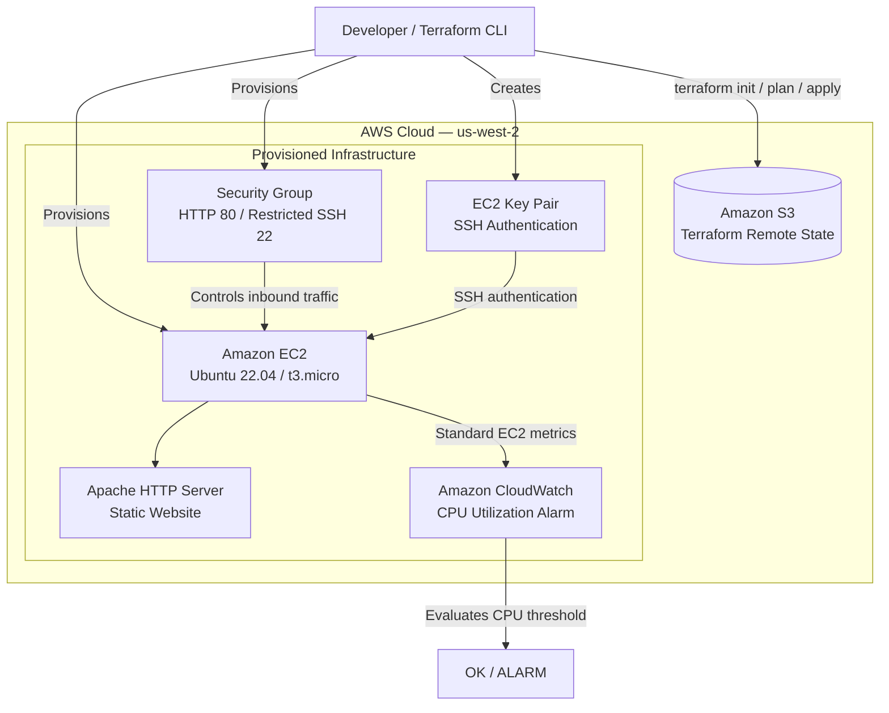

# AWS EC2 Deployment and Monitoring with Terraform

## Project Overview

This project demonstrates the provisioning, configuration, and monitoring of an AWS EC2 instance using Terraform (Infrastructure as Code).

An Ubuntu 22.04 server is deployed on AWS, configured with Apache HTTP Server, and used to host a static website. Amazon CloudWatch monitors the instance's CPU utilization and evaluates alarm conditions.

The project focuses on practical cloud engineering skills, including infrastructure automation, remote state management, network security, Linux administration, and infrastructure monitoring.

## Architecture

The following diagram illustrates the infrastructure and the relationships between the AWS services.



## AWS Services and Tools

| Service / Tool | Purpose |
|---|---|
| Terraform | Infrastructure as Code and resource management |
| Amazon EC2 | Hosts the Ubuntu web server |
| Amazon VPC Security Groups | Controls inbound and outbound traffic |
| Amazon S3 | Stores Terraform remote state |
| Amazon CloudWatch | Monitors EC2 CPU utilization |
| Apache HTTP Server | Serves the deployed website |
| Bash | Automates server configuration and website deployment |

## Infrastructure Provisioning

Terraform provisions the AWS resources required to deploy and operate the web server.

The configuration includes:

- An Ubuntu 22.04 EC2 instance using a dynamic AMI lookup.
- An EC2 key pair for SSH authentication.
- A security group controlling inbound and outbound traffic.
- Security group rules for HTTP and SSH access.
- An S3 backend for remote Terraform state management.
- An EC2 instance state resource to maintain the desired running state.
- A CloudWatch metric alarm for CPU utilization.

### Dynamic AMI Lookup

Instead of hardcoding an AMI ID, Terraform uses an AWS data source to retrieve a matching Ubuntu 22.04 AMD64 image published by Canonical.

This makes the configuration more adaptable when newer matching Ubuntu images become available.

### Remote State Management

Terraform state is stored remotely in an Amazon S3 bucket.

The backend configuration references:

| Configuration | Value |
|---|---|
| Bucket name | `terraformstate116` |
| State key | `terraform/backnd` |
| AWS region | `us-west-2` |

The S3 bucket must exist before running `terraform init`. Terraform creates and manages the state object within the bucket; the `terraform/` portion of the key is an S3 object prefix, not a directory that must be created separately.

## Network Security

An AWS security group controls access to the EC2 instance.

| Protocol | Port | Source | Purpose |
|---|---:|---|---|
| TCP | 22 | Configured public IP address (/32) | SSH administration |
| TCP | 80 | `0.0.0.0/0` | Public HTTP access |

Outbound IPv4 and IPv6 traffic is permitted.

SSH access is restricted to a specific public IP address rather than being exposed to the entire internet. HTTP access is publicly available so visitors can reach the hosted website.

## Web Server Deployment

The EC2 instance runs Ubuntu 22.04 and uses Apache HTTP Server to host a static website.

A Bash provisioning script (`web.sh`) automates the installation and configuration process through EC2 user data.

The script performs the following operations:

1. Updates the Ubuntu package repository.
2. Installs Apache, wget, and unzip.
3. Starts the Apache service.
4. Enables Apache to start automatically when the instance boots.
5. Downloads the Infinite Loop website template from Tooplate.
6. Extracts the website files.
7. Copies the files into Apache's document root.
8. Restarts Apache.

The deployed website is accessible through the EC2 instance's public IPv4 address over HTTP.

## Monitoring with Amazon CloudWatch

Amazon CloudWatch monitors the EC2 instance's CPU utilization.

### CPU Utilization Alarm

A CloudWatch metric alarm is configured with the following parameters:

| Configuration | Value |
|---|---|
| Alarm name | `cool-instance-high-cpu` |
| Namespace | `AWS/EC2` |
| Metric | `CPUUtilization` |
| Statistic | Average |
| Period | 300 seconds (5 minutes) |
| Evaluation periods | 2 |
| Threshold | Greater than 80% |
| Missing data treatment | Not breaching |

The alarm evaluates average CPU utilization over two consecutive five-minute evaluation periods.

When CPU utilization exceeds 80% for the configured evaluation periods, the alarm transitions into the `ALARM` state.

This provides a basic mechanism for identifying potential resource utilization issues on the EC2 instance.

**Notification configuration:** The alarm evaluates CPU utilization but does not currently have an SNS notification action configured.

### EC2 Instance State Management

Terraform also manages the desired state of the EC2 instance through the `aws_ec2_instance_state` resource.

The configuration specifies that the instance should remain in the `running` state. Terraform can detect and reconcile a manually stopped instance during a subsequent plan and apply.

## Screenshots

The following screenshots provide evidence of the infrastructure deployment and monitoring configuration.

### 1. EC2 Instance Deployment


### 2. Website Deployment


### 3. Security Group Configuration


### 4. CloudWatch CPU Alarm


### 5. Terraform Apply


## Deployment Instructions

### Prerequisites

Before deploying the infrastructure, ensure you have:

- An AWS account.
- Terraform installed.
- AWS CLI installed and configured with appropriate permissions.
- An S3 bucket for the Terraform backend.
- An SSH key pair generated locally.

### 1. Clone the Repository

```bash
git clone https://github.com/Stevo0o0/terraform-aws-ec2-monitoring.git

cd terraform-aws-ec2-monitoring
```

### 2. Create the S3 Backend Bucket

Before initializing Terraform, create the S3 bucket referenced in `backend.tf`.

The example configuration uses:

- Bucket: `terraformstate116`
- Region: `us-west-2`

Using the AWS Management Console:

1. Navigate to Amazon S3.
2. Select **Create bucket**.
3. Enter `terraformstate116` as the bucket name.
4. Select `us-west-2` as the region.
5. Keep Block Public Access enabled.
6. Enable bucket versioning.
7. Create the bucket.

Alternatively, use the AWS CLI:

```bash
aws s3api create-bucket \
  --bucket terraformstate116 \
  --region us-west-2 \
  --create-bucket-configuration LocationConstraint=us-west-2
```

Enable versioning:

```bash
aws s3api put-bucket-versioning \
  --bucket terraformstate116 \
  --versioning-configuration Status=Enabled
```

**Important:** S3 bucket names are globally unique. If the example name is unavailable, create a unique bucket name and update the `bucket` value in `backend.tf` before running `terraform init`.

The bucket should have appropriate access controls and encryption enabled. Do not make the bucket public.

### 3. Generate an SSH Key Pair

Generate a local SSH key pair:

```bash
ssh-keygen -t ed25519 -f cool-key
```

This creates:

- `cool-key` — private key.
- `cool-key.pub` — public key.

Keep the private key secure. Neither key needs to be committed to GitHub.

### 4. Configure Terraform Variables

Copy the example variables file:

```bash
cp terraform.tfvars.example terraform.tfvars
```

Update `terraform.tfvars` with your public IP address:

```hcl
my_ip = "YOUR_PUBLIC_IP/32"
```

The configuration also references the local public key file through the `public_key_path` variable. Ensure its path matches the key you generated.

### 5. Initialize Terraform

```bash
terraform init
```

Terraform initializes the AWS provider and configures the S3 backend.

### 6. Validate the Configuration

```bash
terraform fmt -recursive

terraform validate
```

### 7. Review the Execution Plan

```bash
terraform plan
```

Review the proposed infrastructure changes before proceeding.

### 8. Deploy the Infrastructure

```bash
terraform apply
```

Review the execution plan and confirm when prompted.

### 9. Access the Website

After deployment, Terraform displays the EC2 instance's public and private IP addresses.

Open the public IP address in a browser:

```text
http://EC2_PUBLIC_IP
```

### 10. Clean Up Resources

When the infrastructure is no longer required, remove the Terraform-managed resources:

```bash
terraform destroy
```

Review the destruction plan before confirming.

The S3 backend bucket is not managed by this project and will remain in place.

## Key Skills Demonstrated

- Infrastructure as Code using Terraform.
- AWS EC2 provisioning and management.
- Terraform S3 remote state configuration.
- Dynamic AMI lookup using Terraform data sources.
- AWS security group configuration.
- SSH key-based authentication.
- Linux server administration.
- Bash scripting and automated provisioning.
- Apache web server deployment.
- Amazon CloudWatch metrics and alarms.
- Infrastructure lifecycle management.

## Future Enhancements

Planned improvements include:

- Installing and configuring the CloudWatch Agent.
- Centralizing Apache access and error logs in CloudWatch Logs.
- Collecting cloud-init deployment logs.
- Configuring SNS notifications for CloudWatch alarms.
- Expanding infrastructure monitoring and troubleshooting scenarios.

---

**Project Status:** EC2 deployment, Apache web server configuration, Terraform infrastructure management, and CloudWatch CPU utilization monitoring completed.
